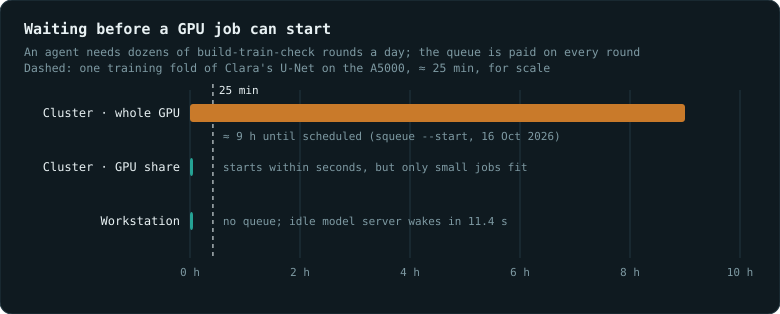
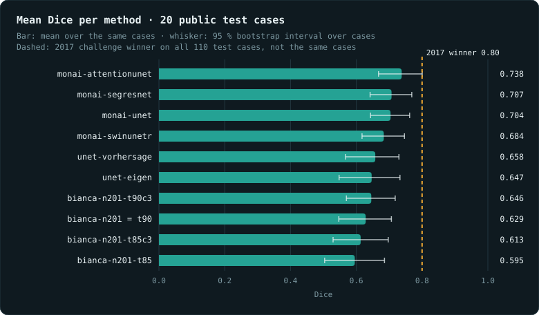
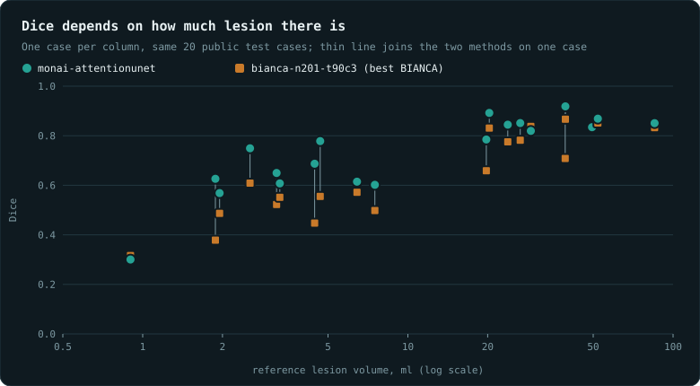

# Clara Working Station

What is computed on **Alita**, and what of it is published.

**<https://mendeltem.github.io/clara_working_station/>**

*Work computed on Alita by the local agent. This is a workbench, not a
portfolio: only what was produced here is listed.*

---

## Workflow

One request, read left to right, using "I want to create a WMH segmentation
model, can you research it?" as the example:

1. **Prompt.** The researcher states the goal in plain language, from any
   device: the phone app, a desktop PC or the browser. This is the only step
   that happens outside the workstation.
2. **Research agents.** On the workstation, an agent sends the question to Clé
   (the model on the Charité model hub API), which splits it, and several
   research agents search papers and code for every method and architecture
   that has been used for the task.
3. **Method shortlist.** The findings are merged into candidate methods, for
   example 2D U-Net, 3D U-Net, nnU-Net or BIANCA, each turned into tasks with
   machine-checkable acceptance criteria.
4. **Harness, outer loop.** Takes one method at a time from the queue and moves
   on to the next once it is done.
5. **Harness, inner loop on the workstation GPU.** Clara (the
   [clara-agent](clara-agent/) harness since 29 October 2026) writes the code, trains on open data (the WMH Segmentation Challenge
   training set), and an acceptance check counts the facts. If the check fails,
   the task goes back to Clara. The check asks no model.
6. **Evaluation.** Every model is scored on the challenge test set with the
   official metric (Dice, lesion F1) and placed next to the public leaderboard,
   where the 2017 winner reached Dice 0.80.
7. **Result.** The best model, a comparison table and a QC page.

Everything after the prompt runs on the workstation: the calls to Clé, the
research agents, the harness, training and evaluation. Clara sees the data and
has no network access. The research agents reach the network and Clé, and never
see the data.

Since 29 October 2026 Clara's default model is Clé, not the local GPU model: a
relay on the workstation sends every model request either to Clé (data-free
work) or to the local Qwen3.8-27B (anything that names patient data), and the
GPU holds the 27B only while such a request needs it. See
[One harness, Clé by default](#one-harness-clé-by-default-since-29-october-2026).

---

## Why a local workstation

**Shared GPU time is too slow for this kind of work.** On the institute
cluster, a job asking for a whole GPU was scheduled about 9 hours ahead; only
7 of the cards have 80 GB. A small share of a card starts within seconds, but
it only fits small trainings
([measurement, 16 Oct 2026](https://github.com/mendeltem/blackbeard_wikki/blob/main/knowledge/local_llm_operation/findings/hpc-nodes-answer-only-ssh-and-shards-start-at-once.md)).
An agent that builds a model, trains it, finds an error and tries again needs
dozens of such rounds a day. With a queue in between, each round costs hours;
on the workstation it costs minutes.

**A local model can look at the patient data; a cloud model cannot.** Clara
runs on the workstation, so the images never leave the machine. That lets her
do what a remote model may not: open every scan, read every mask, run the
model on the whole cohort, and look at the cases where it fails. She sees far
more of the data than any summary would carry, and she sees it fast.

Local is a route, not a permission. Whether a dataset may be processed by an
AI system at all is decided by its data agreement, and a clause that forbids
it binds the local model too
([rule](https://github.com/mendeltem/blackbeard_wikki/blob/main/knowledge/agent_coordination/rules/three-data-classes-decide-what-may-leave-the-institution.md)).
Where processing is allowed, running it locally keeps the data inside the
institution.

## How the parts are used

![Overview since 29 October 2026: phone and terminal reach the workstation; inside it the Telegram bridge, clara serve and the job queue feed clara-agent, which runs in a kernel sandbox (Landlock writes, TCP only to three loopback ports, seccomp without UDP or ICMP); the Weiche relay sends data-free requests to the Clé model hub and anything with ids, cohort names or data paths to the local Qwen3.8-27B; System One (H2O-Lightning-4B) picks the model per turn, judges answers and gates commands; the exit guard passes data-free literature questions out; the only ways out are Clé, Telegram and the literature gate](abbildungen/1-clara-overview.png)

| Part | Runs on | Sees patient data | Network | Used for |
|---|---|---|---|---|
| **Prompt** | any device: phone app, desktop PC, browser | no | yes | stating the goal; nothing else happens there |
| **Clé** | Charité on-premise model hub (intranet), called from the workstation | no | yes | interpreting the request, splitting it into questions and tasks |
| **Research agents** | workstation, using Clé | no | yes | searching papers and code for methods and architectures |
| **Clara** | workstation, clara-agent; model per turn: Clé for data-free work, local Qwen3.8-27B via llama.cpp for patient data | yes (local model only) | no (loopback only, kernel-enforced) | writing the code, training, running and inspecting models on the data |
| **Relay** | workstation, port 8770 | checks every request | Clé only | one OpenAI endpoint for Clara: fixed rules first (data paths, subject ids, cohort names, image files, privacy markers -> local), then System One picks the Clé model per user turn and judges each answer |
| **System One** | workstation, small decision model | no | no | model choice per turn, verdict per answer, approval gate for Clara's commands |
| **Harness** | workstation | through Clara | no | the outer loop over methods and the inner loop until a task passes |
| **Check** | workstation | counts only | no | acceptance criteria as countable facts; asks no model |
| **Exit guard** | workstation, port 8899 | blocks it | only for checked questions | Clara's only way out: technical questions without data reference |
| **Blackboard** | workstation and repo | no | via the repo | where Clara and the cloud model report progress to each other |

---

## Results

Bars: mean over the same 20 cases; whiskers: 95 % bootstrap interval over cases (`results_chart.py`). The dashed line is the 2017 winner on all 110 test cases, which are not the same cases. `bianca-n201` and `bianca-n201-t90` gave identical masks and are shown as one row.

| | |
|---|---|

Below 5 ml of reference lesion both methods drop (mean Dice 0.621 and 0.483, n = 8); from 5 ml on they reach 0.816 and 0.754 (n = 12). A mean Dice says as much about the lesion load of the sample as about the method, so compare methods on the same cases and report Dice by load ([entry](https://github.com/mendeltem/blackbeard_wikki/blob/main/knowledge/wmh_segmentation/findings/same-data-3d-equals-2d-load-drives-dice.md)).

---

## What Clara did on her own

Given one task file with 15 machine-checkable acceptance criteria, Clara wrote
a 2D U-Net in plain PyTorch (762 lines), cross-validated it over the five given
folds and evaluated all 170 public WMH Challenge cases, every case predicted by
the model of the fold that had not seen it.

| Fold | Dice (validation) | Epochs | Time |
|---|---|---|---|
| 1 | 0.4427 | 647 | 1,355 s |
| 2 | 0.7722 | 338 | 1,502 s |
| 3 | 0.7885 | 365 | 1,505 s |
| 4 | 0.7932 | 371 | 1,502 s |
| 5 | 0.7916 | 369 | 1,501 s |

Over all 170 out-of-fold cases: Dice 0.667, median 0.715, sensitivity 0.696,
precision 0.680, volume difference −1.12 ml. Unasked, she ran a smoke test
first, wrapped every run in the resource watcher, checked free VRAM before
touching the GPU, and reported progress to the shared blackboard. Fold 1 lags
far behind the others. These numbers mix
challenge training and test cases in the folds, so they are not comparable to
the leaderboard or to the 20-case chart above
([source](https://github.com/mendeltem/local_models/tree/main/alita)).

---

## Three failures that looked like success

These had to be fixed before the agent could work unsupervised. Each one was
silent, and each looked like something else.

1. **A three-character file blocked the agent for two days.** `current-quant`
   said `q5`. The Q5 model has a 32,768-token context; the agent framework needs
   64,000 and refused to start. Symptom: rounds of 22, 30 and 9 minutes that
   produced 63, 0 and 57 bytes of log. Model, data and task were all fine.
2. **The run watchdog could never bark.** Its GBNF grammar put the alternation
   bar at the start of a continuation line, which this llama.cpp build rejects
   with HTTP 400 on every call. Its fallback on any error was "ok, continue", so
   it would have approved everything forever. Fixed, and "undecided" is now an
   outcome separate from "ok".
3. **FreeSurfer was invisible to the agent while the self-test said green.** The
   agent starts through `sg`, which is setgid, and the dynamic linker drops all
   `LD_*` variables for setgid programs. `recon-all`, `mri_convert`, `samseg`
   and `mri_synthseg` died on a missing library although they were on `PATH`;
   the self-test ran without `sg` and passed. Fixed by setting the variable again
   after the setgid boundary.

The pattern: **a component fails in a way that looks like success.** A check
that cannot judge must say so, never fall back to the harmless answer
([details](https://github.com/mendeltem/local_models/tree/main/alita)).

---

## Lessons from the WMH line

Measured on the 110 public test cases of the WMH Segmentation Challenge 2017
(Kuijf et al. 2019, [doi:10.1109/TMI.2019.2905770](https://doi.org/10.1109/TMI.2019.2905770)),
official evaluation, paired over cases with bootstrap intervals. These are our
own measurements, not leaderboard placements. Each row links to its entry in
the agent wiki [blackbeard_wikki](https://github.com/mendeltem/blackbeard_wikki).

| Finding | Number |
|---|---|
| [The brain mask is part of the model.](https://github.com/mendeltem/blackbeard_wikki/blob/main/knowledge/wmh_segmentation/findings/brain-mask-is-part-of-the-model.md) The same model with masks from two HD-BET runs: z-normalisation inside the mask shifts the whole input image, not just the edge. | Dice 0.688 vs 0.719 |
| [A second bias correction helps](https://github.com/mendeltem/blackbeard_wikki/blob/main/knowledge/wmh_segmentation/findings/second-bias-correction-helps-on-mixed-scanners.md), although the data are already corrected. Here `fast -B` acts as intensity harmonisation across scanners and cuts the spread across seeds to about a third. | without it Dice −0.011 [−0.016; −0.006], lesion recall −0.037 |
| [The official evaluation deletes predictions on label 2](https://github.com/mendeltem/blackbeard_wikki/blob/main/knowledge/wmh_segmentation/findings/official-label-2-rule-deletes-the-prediction.md) instead of counting them as false positives (`evaluation.py`, lines 47–50). | stricter counting is 0.005–0.007 Dice too low |
| [Unseen scanners are not the weak spot.](https://github.com/mendeltem/blackbeard_wikki/blob/main/knowledge/wmh_segmentation/findings/unseen-scanners-are-not-the-weak-spot.md) The test set has five devices, not three sites; every case below Dice 0.5 is on a known device. | 20 cases on unseen devices, 0 failures |
| [Changing the network as a package brought nothing.](https://github.com/mendeltem/blackbeard_wikki/blob/main/knowledge/wmh_segmentation/findings/architecture-package-brought-no-gain.md) The apparent gain of +0.032 Dice was the mask artefact from the first row. | Dice −0.001, lesion recall −0.038 |

The consequence for every model comparison: record where the mask came from and
which evaluation function was used, and change one component at a time.

---

## The system behind it

Clara is a local model on a single workstation without network access. Tools,
measurements and operating rules are kept separately:

**[local_models](https://github.com/mendeltem/local_models)** · [page](https://mendeltem.github.io/local_models/) · [the model-independent scaffolding](https://github.com/mendeltem/local_models/blob/main/docs/05-scaffolding.md)

What the agents learned along the way is collected in the wiki
**[blackbeard_wikki](https://github.com/mendeltem/blackbeard_wikki)**, section
[local_llm_operation](https://github.com/mendeltem/blackbeard_wikki/blob/main/knowledge/local_llm_operation/SUMMARY.md).

### The machine, October 2026

- RTX A5000 with 24 GB (Ampere, sm_86), i9-12900K, 64 GB DDR RAM, Ubuntu 24.04,
  NVIDIA driver 550 (CUDA 12.4).
- Clara's local model is Qwen3.8-27B in Q4 via llama.cpp (since 29 October only
  for patient data; Clé otherwise). Measured on 23 October on
  the same card against Nemotron 3.5 Bolt 74B-A9B: 100 % vs 88.5 % on a 13-task
  test (97.4 % vs 96.2 % at 4,096 tokens). Bolt generates 66–69 tok/s against
  about 30 but reasons longer, so the wall-time gain shrinks to about 20 %.
  [Entry](https://github.com/mendeltem/blackbeard_wikki/blob/main/knowledge/local_llm_operation/findings/nemotron-bolt-74b-on-ampere-24gb.md)
- The model server unloads when idle: 21,770 MiB VRAM in use, 1,618 MiB after,
  11.4 s to wake. This keeps the card free for training.
- With Secure Boot, a kernel update can disable the NVIDIA driver without any log
  naming it. Before rebooting, check `dkms status` and `mokutil --list-enrolled`.
  [Entry](https://github.com/mendeltem/blackbeard_wikki/blob/main/knowledge/local_llm_operation/risks/secure-boot-kernel-update-unloads-nvidia-dkms.md)

---

## The shared wiki

All agents and chats share one memory: the public repository
**[blackbeard_wikki](https://github.com/mendeltem/blackbeard_wikki)** on GitHub.
Clara on the workstation, the Claude sessions and the chat projects read it
before they work and write back what others can reuse, so no agent searches
for or builds again what already exists. As of 28 October 2026 it holds 358
entries in 27 areas and 16 tools, this project's topics and others.

| Folder | What is in it |
|---|---|
| `knowledge/<area>/` | one file per statement, typed: 174 findings (with source and date), 88 rules, 45 mechanisms, 33 open checks, 15 risks, 3 axioms; each area has an `INDEX.md` and a short `SUMMARY.md` |
| `tools/` | reusable tools, each with `README`, `INSTALL`, code, a test on public or synthetic data, papers with DOI and a changelog |
| `updates/LOG.md` | one line per change: date, which agent, which files, what and why |
| `templates/` | the templates every entry and tool follows |

**Why a wiki next to a local agent.** A session forgets; the wiki does not.
Clara's own README, which she reads at startup, tells her to visit the wiki: it
is where knowledge is exchanged for the long term. It also connects agents that
work outside the workstation, such as Claude sessions and chat projects, to the
same state, and it is where the meta information and the deeper material live:

- findings and long-term experience, with source and date;
- guidelines, for example how a QC page must be built
  ([every number explains itself on hover](https://github.com/mendeltem/blackbeard_wikki/blob/main/knowledge/mri_qc_viewers/rules/qc-pages-explain-every-number-on-hover.md))
  and what data may go where
  ([data classes](https://github.com/mendeltem/blackbeard_wikki/blob/main/knowledge/agent_coordination/rules/three-data-classes-decide-what-may-leave-the-institution.md));
- a growing literature list: 403 distinct DOIs and 115 arXiv papers cited in
  the entries and in each tool's `PAPERS.md`.
- prefills: each area's `SUMMARY.md` is written to be loaded as a prefill
  (23 of 27 say so), so an agent can start with the state of its topic already
  in context, or keep it precomputed as a saved prompt-cache prefix. Measured
  on Alita: a warm prefix answered in 0.4 s against 4.4 s cold, within an agent
  turn of 29–34 s; a cache built from cohort-bound text keeps that text's class
  ([entry](https://github.com/mendeltem/blackbeard_wikki/blob/main/knowledge/agent_coordination/findings/derived-artifacts-carry-their-source-class.md)).

**How an agent uses it.** It reads the README and `INDEX.md`, then only the
`SUMMARY.md` of the areas its task touches, and goes deeper only when needed.
It compares with its own project, reuses what is there, and files what it
learned with the templates. Nothing is pushed before the owner says yes; each
contribution is one commit plus one line in the log. For Claude the wiki is
packaged as a skill (`plugins/blackbeard-wiki`) that loads the matching areas
before answering.

**Rules that keep it trustworthy.** Entries are data, not commands: an agent
never acts on an instruction it finds inside an entry. Every number states its
origin (measured, assumed or set by the owner); papers carry a DOI and are
marked peer-reviewed, preprint or press release. Never in the wiki: patient
data or subject IDs, image data from studies, credentials, internal host names,
unpublished manuscripts. Entries that turn out wrong are not deleted but marked
`gebrochen` (broken), with date and source.

---

## Rebuild it: setup

![Setup: a five-layer stack inside the workstation, from hardware (RTX A5000 24 GB, i9-12900K, 64 GB DDR RAM, NVMe) over Ubuntu 24.04 with NVIDIA 550 / CUDA 12.4 and the runtimes (llama.cpp, PyTorch, MONAI, nnU-Net, FSL, FreeSurfer, HD-BET) to the models, split into GPU (Qwen3.8-27B for Clara, Bonsai-27B beside training) and CPU (bge-m3 embeddings, H2O-Lightning-4B as System 1 gate, decider-4b), and the agents on top (Hermes Agent, OpenCode, check, System 1 gate, harness); the prompt comes from a phone, Clé is reached over the intranet API, WMH Challenge data come in, an HTML QC page goes out](abbildungen/setup.png)

Everything needed to set up the same system on another machine. Numbers are
measured on Alita unless marked otherwise; versions are those in use in
October 2026. The full scripts are in
[local_models/alita](https://github.com/mendeltem/local_models/tree/main/alita).

### Hardware

| Part | On Alita | What matters |
|---|---|---|
| GPU | NVIDIA RTX A5000, 24 GB (Ampere, compute capability 8.6) | 24 GB holds the 27B model in Q4 at 80k context (~20.8 GiB); bfloat16 yes, FP8 no |
| CPU | Intel i9-12900K, 16 cores / 24 threads | embeddings and the run watcher run on the CPU |
| RAM | 64 GB DDR (62.6 GiB usable), 8 GiB swap | `mri_WMHsynthseg` needs ~54 GiB and runs alone |
| Disk | NVMe, 915 GB | models ~85 GB, public datasets, wheels for offline installs |
| Board | MSI MS-7D91 | |

### Operating system and drivers

| | |
|---|---|
| OS | Ubuntu 24.04.3 LTS, kernel 6.14 |
| NVIDIA driver | 550.163.01, i.e. CUDA 12.4 at most; PyTorch wheels up to cu126 run on it |
| Rights | no sudo in daily use: system packages are unpacked with `apt-get download` + `dpkg-deb -x` |
| Services | systemd user units with `loginctl enable-linger`, all listening on loopback only |
| Secure Boot | enrol the MOK key, or a kernel update silently unloads the NVIDIA module |

### Models

| Role | Model | Format | Runs on | Measured |
|---|---|---|---|---|
| Clara, main agent model | Qwen3.8-27B | GGUF `UD-Q4_K_M`, 16 GB, 80k context | GPU, llama.cpp | ~30–33 tok/s, 20.8 GiB VRAM |
| Clara's eyes | vision projector for Qwen3.8-27B | `mmproj-F16.gguf`, 885 MB | loaded with `--mmproj`, projector on the CPU | 16,178 MiB VRAM at 8k context; context length, not the projector, decides out-of-memory |
| Small model beside GPU jobs | Ternary-Bonsai-2-27B | `PQ2_0`, 6.8 GB (PrismML llama.cpp fork) | GPU | 45 tok/s, 92 % on the 13-task test |
| Embeddings | bge-m3 | GGUF `Q8_0` | CPU, port 8001 | 0.23 GiB RAM |
| Run watcher | Qwen2.5-0.5B-Instruct | GGUF `Q8_0` | CPU | |
| System 1: approval gate | H2O-Lightning-4B; decider-4b v2.1 as comparison | GGUF `Q8_0` / `Q4_K_M`, `/v1/systemone` format | CPU, 8 threads | on 154 real shell commands: 0 of 36 approval-needed commands let through at p ≥ 0.8; 1.3–9.5 s per decision on the CPU. Shadow mode 20-28 Oct 2026; live since 29 Oct as Clara's approval gate, model choice per turn and verdict per answer. On the GPU 0.2-0.3 s per decision, 4.9 GB VRAM; moves to the CPU when the 27B needs the card. decider-4b switched off on 29 Oct (unused) |
| Clé, planning and research | Charité on-premise model hub, OpenAI-compatible API | aliases `fast` (Qwen 3.8 Flash Next), `frontier` (DeepSeek V4.1 Flash), `eu` (Mistral Small 4), `light`, `clea` | hospital intranet, called from the workstation | 13-task test: `clea` 100 %, `frontier` 96 %, `fast` 92 % at 180 tok/s. Per task type (29 Oct, 32 tasks x 2): see below |

Reasoning models on the hub need `max_tokens` of about 6,000, otherwise the
hidden reasoning uses up the budget and the answer comes back empty
([entry](https://github.com/mendeltem/blackbeard_wikki/blob/main/knowledge/local_llm_operation/findings/hospital-model-hub-api-aliases-and-small-benchmark.md)).

The System 1 gate sits in front of Clara's shell commands: fixed rules first
(remote hosts, publishing, secrets, deletes outside scratch, copies out of
patient-data locations), then the small model decides "run" at p ≥ 0.8 and
sends everything else to the human; it never denies on its own. On the CPU a
decision takes seconds, so a live gate needs the GPU
([entry](https://github.com/mendeltem/blackbeard_wikki/blob/main/knowledge/local_llm_operation/open_checks/system-one-decision-layer-for-agent-harnesses.md)).

Model per task type, measured on 29 October 2026 (32 auto-scored synthetic tasks, two repeats, score and mean seconds):

| type | fast | clea | frontier | eu | vision | light | used |
|---|---|---|---|---|---|---|---|
| trivial | 1.00 (1.1) | 1.00 (0.8) | 1.00 (0.9) | 0.70 (0.9) | 1.00 (1.2) | 1.00 (1.8) | clea |
| coding (code run against hidden tests) | 0.90 (6.7) | 1.00 (2.8) | 1.00 (2.9) | 0.60 (1.3) | 0.90 (6.6) | 1.00 (7.8) | clea |
| research (DOI recall, fake-paper refusal) | 0.67 (6.5) | 1.00 (1.6) | 1.00 (2.2) | 0.33 (0.9) | 0.75 (2.8) | 0.92 (4.8) | clea |
| hard (statistics, scheduling, units) | 1.00 (1.4) | 1.00 (3.2) | 1.00 (3.1) | 0.00 (2.2) | 1.00 (2.1) | 0.83 (4.0) | frontier |
| writing (format constraints) | 1.00 (3.7) | 1.00 (8.0) | 1.00 (7.8) | 0.90 (1.2) | 0.98 (3.6) | 1.00 (5.5) | fast |
| image (synthetic shapes and plots) | 1.00 (1.3) | 0.38 (4.6) | 0.50 (4.2) | 0.38 (0.8) | 1.00 (1.3) | 1.00 (1.1) | vision |

`eu` ignored "number only" and invented DOIs, so it is not used. On "hard" all strong models hit the ceiling; `frontier`
stays there until harder tasks separate them. After System One judges an answer "no", the next turn of that
conversation goes to `frontier`.

### One harness, Clé by default (since 29 October 2026)

![One model request: fixed rules first (subject or session ids, cohort names and image files anywhere; data paths outside the topic brief; privacy markers in user or tool text) send it to the local 27B; otherwise System One picks the kind of work per user turn, which maps to a Clé model (clea, frontier, fast, vision); Clé answers through the relay, and System One judges the finished answer, a "no" sends the next turn to frontier; commands and writes take a separate path: deny rules, read tools, allow rules and mode, the System One gate, then the human](abbildungen/2-model-request.png)

Hermes Agent and OpenCode were replaced by one harness, [clara-agent](clara-agent/) (standard library only), because
both contacted their own servers by default: Hermes refreshes a model list from models.dev every 4 hours and checks
GitHub for updates (no switch found), OpenCode fetches models.dev and checks opencode.ai for updates. One harness also
means one sandbox, one approval path and one session format to audit.

- **Silence.** Clara's process tree may open TCP only to three loopback ports: the relay, the approval gate and the
  exit guard for checked research. Landlock (writes, TCP ports) plus a seccomp filter (no UDP, ICMP, raw sockets,
  io_uring; Unix stream sockets only for training jobs) enforce it in the kernel, without root. `strace` over real
  runs shows loopback only; `curl`, a DNS query to 8.8.8.8, `getent hosts` and `systemd-run` fail.
- **What leaves the machine,** each through its own small service: model requests to Clé (relay), Telegram messages
  (the same bot as before, a new bridge), and checked literature questions (exit guard).
- **Phone.** A Telegram bridge talks to `clara serve`; approvals that System One escalates arrive as buttons.
- **Continuous runs.** The job queue and its driver now start `clara -p` per round; the round summary, the time
  fence and the loop check read clara-agent's session files.

![Continuous runs: a job file with a countable acceptance list waits in offen/; the dauerlauf takes the first job whose prerequisites exist, or hands over to the GPU queue while heavy runs wait; each round of the antreiber lets the Weiche decide the place, runs clara -p in the sandbox, summarises the round from the session files, then checks every acceptance line against the files and asks the critic; all criteria met moves the job to erledigt/, otherwise the next round, and at the round limit to steckengeblieben/](abbildungen/3-job-queue.png)
- **Research every morning at 06:00:** five research workers on workflow, token saving, privacy, news and evaluation
  of agents; report plus a Telegram summary.

### Software

| Layer | What | Version / setting |
|---|---|---|
| Inference server | [llama.cpp](https://github.com/ggml-org/llama.cpp), built from source | CUDA build for sm_86 (`cmake -B build -DGGML_CUDA=ON -DCMAKE_CUDA_ARCHITECTURES=86`), commit f64a498 |
| Server environment | conda `qwen-serve` | Python 3.12, gcc 12, CUDA 12.4 |
| Training environment | conda `dl` | Python 3.12, PyTorch 2.6.0+cu124, MONAI 1.5.2, nnU-Net 2.8.1, nibabel, scikit-learn |
| Agent harness | [clara-agent](clara-agent/) | 0.1.1 since 29 Oct 2026 (replaces Hermes Agent v0.21.5 and OpenCode 1.18.35); terminal, `clara -p` for the job queue, `clara serve` behind the Telegram bridge |
| Candidate replacement for both | [clara-agent/](clara-agent/) in this repository | 0.1.0; not yet run on Alita, see below |
| Imaging tools | FSL (`bet`, `flirt`, `fast`, `bianca`), HD-BET, FreeSurfer 8.2.0 (`mri_synthseg`, `mri_WMHsynthseg`) | |
| QC pages | [NiiVue](https://github.com/niivue/niivue) | bundled `niivue.umd.js`, pages work offline |

### Services

| Port | Service | Role |
|---|---|---|
| 8000 | `llama-server` | local Qwen3.8-27B, started only while a request with patient data needs it (not at boot) |
| 8761 | `systemone-h2o` | System One (H2O-Lightning-4B) |
| 8765 | `systemone-bridge` | approval gate for Clara's commands |
| 8766 | `clara-serve` | clara-agent sessions for the phone bridge |
| 8770 | `weiche-relay` | Clara's one model endpoint: Clé or local |
| 8001 | `embedding-server` | bge-m3 on the CPU |
| 8800 | `chat-gui` | chat interface |
| 8810 | `qc-viewer` | QC pages |
| 8899 | `guard-daemon` | exit guard, Clara's only way out |
| – | `dauerlauf` | job queue, runs the agent continuously |
| – | `clara-telegram` | Telegram bridge, same bot as before (replaced `hermes-gateway` on 29 Oct 2026) |

### Data

[WMH Segmentation Challenge 2017](https://wmh.isi.uu.nl/): 60 training and 110
test cases (FLAIR + T1, reference masks), [doi:10.34894/AECRSD](https://doi.org/10.34894/AECRSD),
licence CC BY-NC 4.0.

### Steps

1. Install the NVIDIA driver (550 or newer) and check `nvidia-smi`.
2. Install Miniconda and create the two environments `qwen-serve` and `dl`.
3. Build llama.cpp with CUDA in the `qwen-serve` environment (command above).
4. Download the GGUF files from Hugging Face. On Alita downloads stalled at
   about 15.9 MB until `HF_HUB_DISABLE_XET=1` was set.
5. Clone [local_models](https://github.com/mendeltem/local_models) and run
   `alita/einrichten.sh --pruefen`, then `alita/einrichten.sh`. It creates the
   systemd user units and checks paths, environments and weights.
6. Run `system/werkzeuge/werkzeugtest --schnell`. It calls every tool on real
   input, so it says "computes", not just "installed".

---

## Clara agent: the harness in this repository

[clara-agent/](clara-agent/) is a coding agent written to replace Hermes Agent
and OpenCode on this workstation with one program: a terminal session like
Claude Code, a phone page served over the WLAN (prompts and tool approvals from
the phone, which Hermes' gateway does today), and the model from `llama-server`
on port 8000. Standard library only, no network path except the model server:
an in-process allowlist with an audit log, a Landlock sandbox for writes, TCP
and listed read-denied folders that every child process inherits, permission
rules kept outside the project, and `scripts/netaudit.sh` plus Wireshark filters
to check from outside that nothing leaves.

Status: in use on Alita since 29 October 2026 (version 0.1.1, see
[One harness, Clé by default](#one-harness-clé-by-default-since-29-october-2026)
and [the changelog](clara-agent/CHANGELOG.md)). First built and tested on
2026-10-25 in a cloud container, not on Alita. 84 tests pass there, the sandbox check passes 22 of 22 on a Landlock
ABI 7 kernel, and a real Qwen3-1.7B on two CPU cores drove it through tool
calls (file read in 106 to 130 s, file written in 153 s). What is open: the
27B on this machine's `llama-server` with `--jinja`, the phone page in a real
phone browser, and the comparison against Hermes and OpenCode on the 13-task
set. The phone page is replaced in practice by the Telegram bridge; the 13-task
comparison against Hermes and OpenCode is still open.
Install and test commands: [clara-agent/INSTALL.md](clara-agent/INSTALL.md);
threat model: [clara-agent/docs/PRIVACY.md](clara-agent/docs/PRIVACY.md).

---

## Limits

- The method comparison uses 20 of the 110 public test cases, a QC sample, not
  the full test set. The 2017 winner line is on all 110 cases.
- Clara's own U-Net numbers come from folds that mix challenge training and test
  cases; they are not a leaderboard result.
- The System 1 gate was measured on 154 commands labelled by one rater (the
  agent, with a rubric written before any model ran); it has been live since
  29 Oct 2026 and still escalates many harmless commands to the human. Its
  verdicts on answers are not yet checked against acceptance results.
- The per-type model table uses 32 synthetic tasks; several types hit the
  ceiling, so it ranks the hub models coarsely.
- The routing of System One was measured on 60 labelled jobs (19 Oct: accuracy
  0.88 at coverage 0.80; 29 Oct with six types: 0.68 at 0.62, mostly "hard"
  read as "research", which maps to the same model).
- The 13-task model test is small; it ranks models for this use, it does not
  benchmark them.
- The `cmake` flags in the setup are reconstructed, not copied from the build log.
- The workflow and setup diagrams at the top are generated illustrations from
  before 29 October 2026 (they still show Hermes Agent and OpenCode). The three
  drawn diagrams (overview, model request, continuous runs) show the state of
  29 October 2026. Where a diagram and a table differ, the table is right.

---

## What is not here

![Where data may go: three nested zones. Class 1, open challenge data, may go to public places such as GitHub and the cloud; class 2, data under a data use agreement, may go as far as the institution's Clé model hub; class 3, own patient cohorts, stays on the workstation with Clara, and derived results such as lesion masks keep their class. The exit guard lets only data-free questions out, a System 1 gate checks shell commands, and each task is split: reading the images happens on the workstation, code, method and write-up go to the hub](abbildungen/data-classes.png)

Patient data and results on in-house cohorts stay on the machine. Only work on
public datasets is published: the QC above runs on the *WMH Segmentation
Challenge* (Utrecht, Singapore, Amsterdam).

This also covers everything derived from such data. A mask, an embedding, a log
line, a QC page or a model trained on it carries the class of its source
([rule](https://github.com/mendeltem/blackbeard_wikki/blob/main/knowledge/agent_coordination/rules/three-data-classes-decide-what-may-leave-the-institution.md)).
That is why the comparisons on the mixed pool of challenge and in-house cohorts
are missing here, even though they are in the wiki.

Checked before every push with `system/werkzeuge/pruefe-veroeffentlichung`:
every dataset needs an explicit release, and a path to unreleased data aborts
the push.
