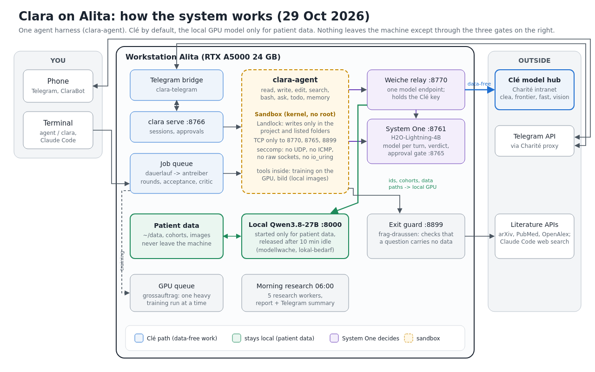
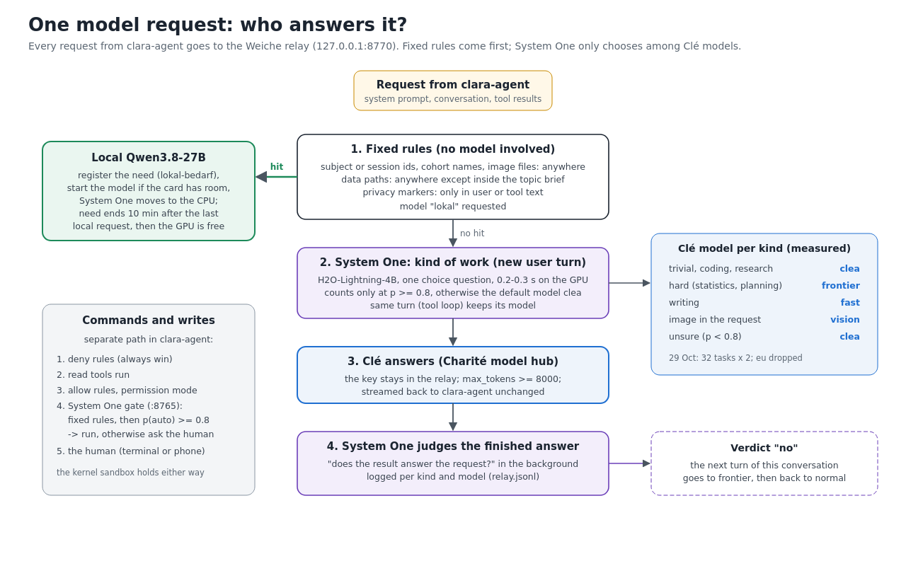

# clara-system: the self-written parts around clara-agent

These are the pieces that run Clara on the workstation since 29 October 2026. Together with
[clara-agent](../clara-agent/) they replace Hermes Agent and OpenCode. Clara talks only to loopback; three small
services of our own are the only ways out: the model hub, Telegram and checked literature questions.



| Path | What it does |
|---|---|
| `weiche/relay.py` | One OpenAI-compatible endpoint on `127.0.0.1:8770` for clara-agent. It applies fixed rules first: subject or session ids and cohort names in any text, or data opened through the project or a tool call, send the request to the local model. Everything else goes to the hospital model hub (Clé). It holds the hub key, so the agent never sees it. Reading public files (the wiki, Clara's own skills) does not count as data access. If a conversation does not fit the local model's context, the relay retries once with the oldest steps dropped. Every hub request is logged with the tokens the hub reported. |
| `weiche/weiche.py` | The decision itself, also callable on its own (`weiche entscheiden / bewerten / frag / messen`). A small decision model ("System One", H2O-Lightning-4B behind a `/v1/systemone` endpoint) picks the kind of work for each user turn; the kind maps to a hub model at p >= 0.8. System One also judges each finished answer: a "no" sends the next turn to the strongest model. Scripts that call it go through the relay when it runs, so the same fixed rules apply and the hub key stays in one place; `weiche verbrauch` prints hub tokens per day and source. |
| `weiche/weiche.example.json` | Configuration template: hub URL, the type -> model map, the threshold, data folders and id patterns. Copy it to `weiche.json` and add your own cohort names; `weiche.json` is git-ignored. Released open datasets (`oeffentlich`, valid only while their release file exists) and structure-only folders (`keine_daten`) are not treated as patient data. |
| `weiche/modellwahl.py` | The measurement behind the type -> model map: 32 auto-scored synthetic tasks (trivial, coding, research, hard, writing, image), two repeats per hub model. |
| `telegram/clara_telegram.py` | Telegram bridge: long-polls the bot (through a proxy if `https_proxy` is set) and drives `clara serve`. Approvals that System One escalates arrive as buttons. It updates a status line while Clara works, reattaches after a restart without replaying old answers, and re-sends prompts that are still open. Commands: `/new`, `/local`, `/stop`, `/mode`, `/status`. |
| `werkzeuge/clara-lauf` | Starts one job of the job queue with `clara -p --yolo` in the sandbox, or an interactive session. Write paths come from a shared list, and a topic brief is prepended as a prefill. It keeps two homes: a local one with full memory and a hub one with hub-safe memory. |
| `werkzeuge/clara-sitzungen` | Reads clara-agent's session files. It prints the round summary, the last message time (for the job queue's time limit), loops (the same tool error three times in a row), silent sessions, a live view and a daily error tally. |
| `werkzeuge/lokal-bedarf` | Register of processes that need the local GPU model. A watcher keeps the model server up only while an entry lives. |
| `werkzeuge/bild` | Local image generation: Z-Image Turbo with stable-diffusion.cpp built for CUDA. It refuses with rc 3 when the card has less than 6 GB free. |
| `dienste/*.service` | systemd user units for the relay, `clara serve` and the Telegram bridge (`%h` = your home). |

## How a request is decided



## Install

Needs Linux, Python 3.11+ and an OpenAI-compatible hub or local server. The Weiche also needs a System One endpoint;
if it is down, every request gets the default model `clea`.

```bash
git clone https://github.com/mendeltem/clara_working_station
cd clara_working_station
python3 -m venv --system-site-packages ~/.clara-venv && ~/.clara-venv/bin/pip install --no-build-isolation ./clara-agent
cp clara-system/weiche/weiche.example.json clara-system/weiche/weiche.json   # then add your data folders and cohort names
mkdir -p ~/.config/cle && printf '%s\n' "<your hub key>" > ~/.config/cle/api_key && chmod 600 ~/.config/cle/api_key
python3 -I clara-system/weiche/relay.py --port 8770                        # in a second terminal
CLARA_BASE_URL=http://127.0.0.1:8770/v1 CLARA_MODEL=auto ~/.clara-venv/bin/clara
```

For the services, copy `dienste/*.service` to `~/.config/systemd/user/` and adjust the paths in `ExecStart`. Put the
bot token, the allowed user ids and the home chat into `~/.config/clara/telegram.env` (chmod 600) as
`TELEGRAM_BOT_TOKEN=...`, `TELEGRAM_ALLOWED_USERS=...` and `TELEGRAM_HOME_CHANNEL=...`.

## Configuration through the environment

| Variable | Default | Used by |
|---|---|---|
| `CLARA_SYSTEM` | `~/local_agentic_system/system` | `clara-lauf` (topic briefs in `themen/`, write list `schreibsperre.liste`) |
| `CLARA_LAUF_HOME` | `~/.clara-lauf` (local) / `~/.clara-lauf-cle` (hub) | `clara-lauf` |
| `CLARA_MEM_LOKAL`, `CLARA_MEM_CLE` | memory files to start a new home with | `clara-lauf` |
| `WEICHE_ERGEBNISSE` | `~/local_agentic_system/ergebnisse/weiche` | logs of decisions, relay requests and verdicts (private: they hold job texts) |
| `LOKAL_BEDARF_DIR` | `~/data/work/.llm-lokal` | `lokal-bedarf` |
| `SD_CPP`, `BILD_MODELLE` | `~/local_agentic_system/system/sd.cpp`, `.../modelle/bild` | `bild` |
| `CLARA_TG_ENV`, `CLARA_SERVE`, `https_proxy` | `~/.config/clara/telegram.env`, `http://127.0.0.1:8766`, none | Telegram bridge |

## What this does not cover

- The local model server, its starter `modellstart` (checks free VRAM before loading) and the watcher are
  workstation-specific and are not included. Without a starter, the relay assumes that the local server is
  already up.
- The approval gate (`/v1/chat/completions` on `127.0.0.1:8765`, Hermes smart-approval format) and the System One
  service are described in the main README; they are not part of this folder.
- Tool names and flags are German (`clara-sitzungen --seit`, `bild --gross`) because the rest of the workstation calls
  them that way; comments and messages are English.

Measured results (sandbox checks, routing, per-type model table, image timings) are in the main
[README](../README.md#one-harness-clé-by-default-since-29-october-2026).
